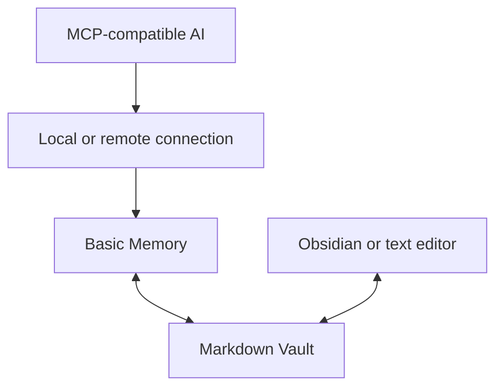

# AI-Vault

[한국어](README.md) · English

**Keep working when you switch AI assistants.**

Save important decisions and next steps in Markdown notes, then let another assistant read them and continue.
Built on [Basic Memory](https://docs.basicmemory.com/), this repository provides connection examples, note templates, and a setup skill. Obsidian is optional.

**New here? Start with [Getting started](#getting-started). Already connected? Jump to [Three everyday requests](#three-everyday-requests).**

## What can you do?

| Situation | Use AI-Vault to… |
|---|---|
| Plan with one assistant and implement with another | Save decisions and reasoning for the next assistant |
| Avoid explaining previous conversations again | Read the current summary and retrieve supporting details as needed |
| Keep track of progress | Distinguish completed, unverified, and deferred work, plus next steps |

### Example note

*This fictional notes-app example illustrates a summary; it does not describe an actual implementation.*

| Item | Note |
|---|---|
| Decision | Use local storage for the first version because of the schedule |
| Status | Assume list and search are implemented; build and real usage remain unverified |
| Deferred | Cloud synchronization service selection |
| Next step | Build and check actual behavior |

Include only relevant items. Omit decisions or deferred items when there are none.
[See the complete demo note](examples/demo-vault/Projects/Sample-Notes-App.md) (Korean).

## Getting started

You need **Python 3.12+, Basic Memory, and an AI client that supports MCP connections**. The repository's helper scripts alone require Python 3.11+.

```sh
git clone https://github.com/UiHyeon-Kim/ai-context-vault.git
cd ai-context-vault
```

1. **Connect** — Follow the [installation and first connection guide](docs/quickstart.md) to register a demo Vault and connect your assistant.
2. **Register instructions once** — Use the [setup guide](docs/agent-setup.md) to choose the assistant, Vault, alias, scope, and save policy. The default is **save only when requested**.
3. **Verify** — In a new chat, ask “Record the connection test result in Vault,” then “Read the note you just saved.”

The setup skill prepares rules for your assistant's instruction file or user instructions. Cloning this repository alone does not connect the tools or register those rules.

> Documents and templates can be used on Windows, macOS, and Linux. Connection examples use macOS; actual client connections on Windows and Linux remain unverified. [Environment-specific verification](docs/status.md#지원-환경)

Detailed guides, skill instructions, and demo notes are currently in Korean. This English README covers the same entry points and limitations as the Korean README; it does not imply that all linked content is translated.

## Three everyday requests

Use these after connecting the tools and registering instructions.

| Goal | Request |
|---|---|
| Save | **“Record this in Vault.”** |
| Resume | **“Read the notes-app work in Vault and continue.”** |
| Hand off | **“Write a handoff in Vault so another assistant can continue.”** |

These are natural-language requests. Connect the same Vault and register instructions in each assistant.
**You can choose an alias.** For example, set it to `My notes` and ask “Record this in My notes.” This does not rename the actual project or folder. [Naming guide](docs/naming.md)
[More usage examples](docs/usage.md)

## Change the alias or save policy

Use an assistant with the setup skill installed, or one that can read its file.

| Setting | Example request |
|---|---|
| Inspect settings | “Show the configured alias, project, and save policy.” |
| Change the alias | “Set the Vault alias to My notes.” |
| Save policy | “Save only when I ask” / “Also record important decisions.” |
| Scope | “Apply this only to this project” / “Apply this to my personal instructions.” |

Check the target and existing instructions before changing them, then verify in a new chat. Renaming the actual project ID, folder, or app connector is a separate task. Apply settings separately to each assistant. [Setup details](docs/agent-setup.md)

## Things to know

- **Only saved notes are shared.** This is not real-time conversation synchronization or an automatic summarization service.
- **Verify actual saves.** Read the note again instead of relying only on the assistant's completion message. Automatic skill discovery, instruction registration, and saving in a new session were verified in temporary macOS environments with Codex CLI and Claude Code. The same flow in actual user profiles and other apps remains unverified.
- **Connection methods vary.** Check MCP support, authentication, and permissions. Remote access requires the Vault computer and connection service to be running.

<details>
<summary>Connection structure and verification scope</summary>



Historical connection records cover Codex, Claude Code, Claude Desktop, ChatGPT, and dots. Other assistants require individual tests.
Basic Memory 1.0.0 text search, writes, edits, and readback were verified in a temporary macOS environment. Online semantic search was outside that test. CI pins Basic Memory 0.22.1 for its required integration test; the latest-version test is experimental.
[1.0 compatibility](docs/basic-memory-compatibility.md) · [Setup verification](docs/setup-skill-verification.md) · [Historical connections](docs/verification.md) · [Chat verification](docs/chat-verification.md) · [Feature scope](docs/status.md)

</details>

## More information

[Troubleshooting](docs/troubleshooting.md) · [Backup and recovery](docs/maintenance.md) · [Remote access and startup](docs/setup.md) · [Note structure and templates](docs/context-structure.md)

[Convenience features and verification status](docs/status.md#편의-기능-현황)

Report problems or suggest improvements through [Issues](https://github.com/UiHyeon-Kim/ai-context-vault/issues) or a pull request. Include your environment and reproduction steps; leave out personal notes and credentials.

[MIT](LICENSE) applies to this repository. External tools have their own licenses; see the [license notes](docs/license-options.md).
