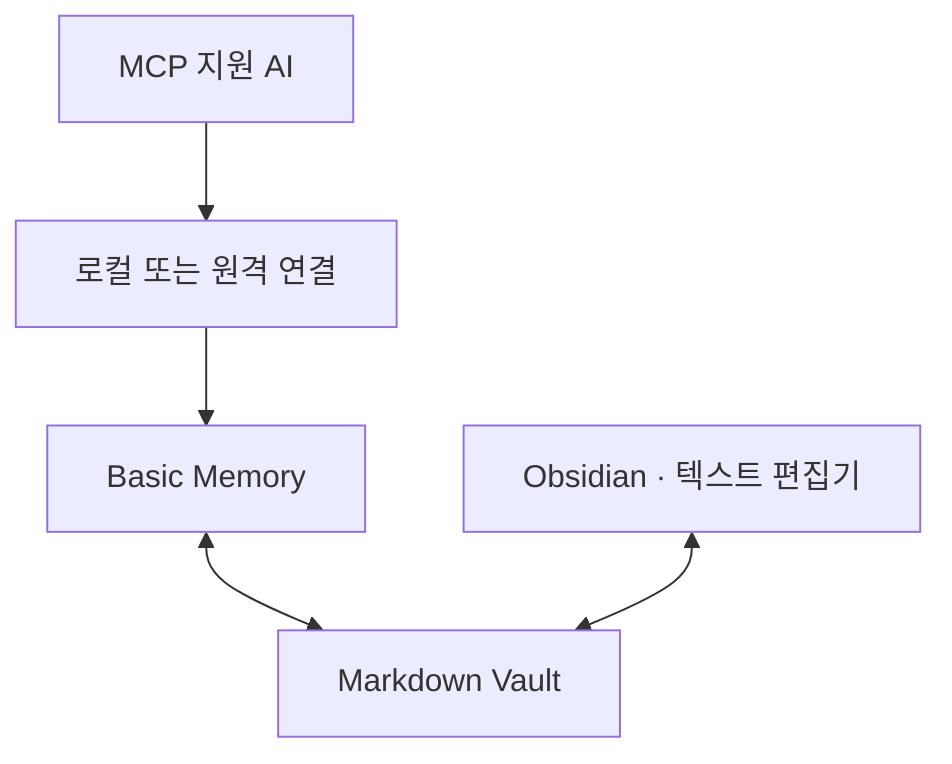

# AI-Vault

**AI를 바꿔도, 하던 작업을 이어가세요.**

중요한 결정과 남은 일을 Markdown 노트에 저장하고 다른 AI가 읽어 이어갑니다.
[Basic Memory](https://docs.basicmemory.com/)를 기반으로 연결 설정·기록 양식·초기 설정 스킬을 제공합니다. Obsidian은 선택 사항입니다.

**처음이라면 [시작하기](#시작하기)만 따라가세요. 이미 연결했다면 [이 세 문장으로 사용하기](#이-세-문장으로-사용하기)로 이동하세요.**

## 무엇을 할 수 있나요?

| 상황 | AI-Vault로 하는 일 |
|---|---|
| 기획은 한 AI에서, 구현은 다른 AI에서 | 결정과 이유를 저장하고 다음 AI가 이어받기 |
| 지난 대화를 다시 설명하기 번거로울 때 | 현재 요약부터 읽고 필요한 근거만 찾아보기 |
| 어디까지 했는지 헷갈릴 때 | 완료·미검증·보류와 다음 할 일을 구분하기 |

### 저장되는 기록 예시

*가상의 메모 앱 작업을 요약한 예시입니다. 실제 구현 결과가 아닙니다.*

| 항목 | 기록 |
|---|---|
| 결정 | 첫 버전은 로컬 저장만 사용 — 일정 때문 |
| 현재 상태 | 메모 목록·검색 구현으로 가정, 빌드·실사용은 미검증 |
| 보류 | 클라우드 동기화 서버 선택 |
| 다음 할 일 | 빌드와 실제 동작 확인 |

필요한 항목만 씁니다. 정해진 결정이나 보류 사항이 없다면 해당 항목은 생략합니다.
[전체 데모 노트 보기](examples/demo-vault/Projects/Sample-Notes-App.md)

## 시작하기

준비물은 **Python 3.12 이상 · Basic Memory · MCP 연결을 지원하는 AI**입니다. 저장소의 보조 스크립트만 실행할 때는 Python 3.11 이상이면 됩니다.

```sh
git clone https://github.com/UiHyeon-Kim/ai-context-vault.git
cd ai-context-vault
```

1. **연결하기** — [설치·첫 연결 가이드](docs/quickstart.md)를 따라 데모 Vault를 등록하고 사용할 AI에 연결합니다.
2. **규칙 한 번 등록하기** — [초기 설정 안내](docs/agent-setup.md)에서 AI·Vault·부를 이름·적용 범위·저장 방식을 고릅니다. 기본은 **요청할 때만 저장**입니다.
3. **확인하기** — 새 채팅에서 “연결 시험 결과를 Vault에 기록해줘”라고 요청한 뒤, “방금 저장한 노트를 읽어줘”로 확인합니다.

초기 설정 스킬은 선택한 AI의 지침 파일이나 사용자 지침에 넣을 규칙을 준비합니다. 저장소를 받기만 해서는 연결이나 지침 등록이 완료되지 않습니다.

> 문서·양식은 Windows·macOS·Linux에서 사용할 수 있습니다. 연결 예시는 macOS 기준이며 Windows·Linux의 실제 앱 연결은 미검증입니다. [환경별 확인 범위](docs/status.md#지원-환경)

## 이 세 문장으로 사용하기

연결과 규칙 등록을 마친 AI에 요청하세요.

| 하고 싶은 일 | 이렇게 말하세요 |
|---|---|
| 저장 | **“Vault에 기록해줘”** |
| 재개 | **“Vault에서 메모 앱 작업 읽고 이어서 하자”** |
| 인계 | **“다른 AI가 이어받게 Vault에 인계해줘”** |

CLI나 슬래시 명령이 아닌 자연어 요청입니다. AI마다 같은 Vault를 연결하고 규칙을 등록해야 합니다.
**이름도 고를 수 있습니다.** 초기 설정에서 호칭을 `내 메모장`으로 정하면 “내 메모장에 기록해줘”로 사용합니다. 실제 프로젝트·폴더 이름은 바뀌지 않습니다. [이름 변경 안내](docs/naming.md)
[사용 예시 더 보기](docs/usage.md)

## 알아둘 점

- **저장한 노트만 공유합니다.** 전체 대화의 실시간 동기화나 자동 요약 서비스는 아닙니다.
- **실제 저장을 확인하세요.** AI의 완료 답변뿐 아니라 노트를 다시 읽어 확인합니다. 초기 설정 스킬은 macOS의 Codex CLI·Claude Code 임시 환경에서 자동 발견·지침 등록·새 세션 저장까지 확인했습니다. 실제 사용자 프로필과 다른 앱의 같은 흐름은 미검증입니다.
- **연결 방식은 AI마다 다릅니다.** MCP 지원 여부·인증·권한을 확인해야 합니다. 원격 연결은 Vault 컴퓨터와 연결 서비스가 실행 중이어야 합니다.

<details>
<summary>연결 구조와 검증 범위 보기</summary>



Codex·Claude Code·Claude Desktop·ChatGPT·dots의 기존 연결 기록이 있습니다. 다른 AI는 개별 시험이 필요합니다.
Basic Memory 1.0.0의 텍스트 검색·저장·수정·재조회를 macOS 임시 환경에서 확인했습니다. 온라인 의미 검색은 이번 검증에 포함하지 않았습니다. CI의 고정 연동 시험 대상은 Basic Memory 0.22.1이며 최신 버전은 실험적입니다.
[1.0 호환성](docs/basic-memory-compatibility.md) · [초기 설정 검증](docs/setup-skill-verification.md) · [기존 연결 기록](docs/verification.md) · [실제 채팅 검증](docs/chat-verification.md) · [기능별 범위](docs/status.md)

</details>

## 필요할 때만 찾아보기

[문제 해결](docs/troubleshooting.md) · [백업·복구](docs/maintenance.md) · [원격 연결·자동 실행](docs/setup.md) · [노트 구조·양식](docs/context-structure.md)

[편의 기능 구현·검증 현황](docs/status.md#편의-기능-현황)

문제 제보·개선 제안은 [Issues](https://github.com/UiHyeon-Kim/ai-context-vault/issues) 또는 PR로 남겨 주세요. 사용 환경과 재현 방법을 적되 개인 노트·인증 정보는 제외해 주세요.

[MIT](LICENSE) — 이 저장소에 적용됩니다. 외부 도구의 라이선스는 [별도 안내](docs/license-options.md)를 참고하세요.
