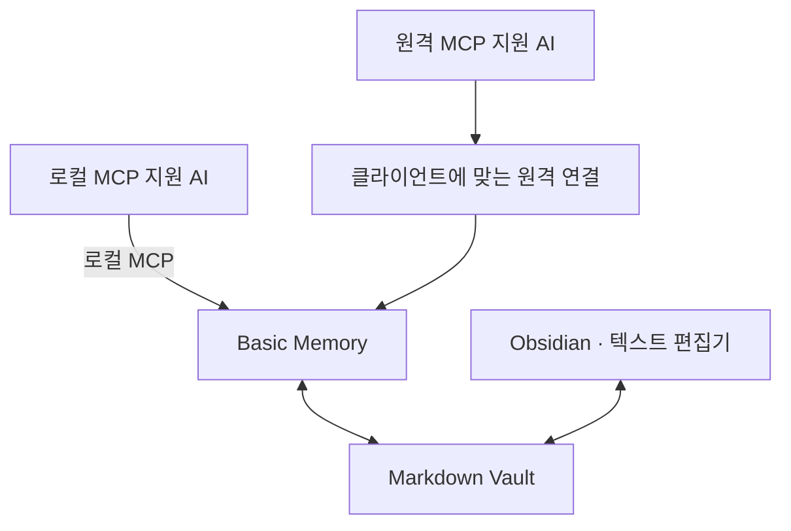

# AI-Vault

**MCP를 지원하는 AI들이 같은 Markdown 노트를 읽고, 이전 작업의 결정과 근거를 이어받도록 돕는 스타터킷**

[빠른 시작](#빠른-시작) · [사용법](docs/usage.md) · [설정 가이드](docs/setup.md) · [문제 해결](docs/troubleshooting.md)

여러 AI를 번갈아 쓰면서 기획과 진행 상황을 매번 옮겨 적는 사람을 위한 구성입니다. 중요한 결정·이유·남은 일을 로컬 노트에 저장하고, 다음 AI가 그 노트를 읽어 작업을 이어갑니다. 공유 대상은 **저장한 노트**이며 전체 채팅의 실시간 동기화는 제공하지 않습니다.

노트 검색·읽기·쓰기는 [Basic Memory](https://docs.basicmemory.com/)가 담당합니다. 이 저장소는 연결 설정, 공통 지침, 인계 양식과 설치·검증 도구를 제공합니다. Obsidian은 노트를 직접 읽고 편집할 때 선택해서 사용할 수 있습니다.

> **문서·양식·기록 규칙은 운영체제와 무관하게 사용할 수 있습니다.** 연결 과정은 macOS에서 검증했고, Windows·Linux는 도구의 CI 시험 기록만 있습니다. 자동 실행 예시인 LaunchAgent는 macOS 전용입니다. 원격 연결은 별도 설정과 실행 중인 Vault 컴퓨터가 필요합니다.

## 무엇을 할 수 있나요?

- **AI 사이에서 작업 이어가기** — 기획을 저장하고 다른 AI에서 같은 노트를 읽어 구현·조사를 재개합니다.
- **필요한 맥락부터 읽기** — 현재 요약을 먼저 조회하고 상세 이력은 근거가 필요할 때 읽습니다.
- **결정과 검증 상태 구분하기** — 사용자 결정·AI 제안, 구현·테스트·실사용, 보류·금지 범위를 나누어 기록합니다.
- **설정을 점검하고 적용하기** — 사전 검사와 변경 미리보기를 거쳐 MCP 연결 설정을 병합합니다.

AI가 남기는 기록은 다음과 같습니다. 아래 내용은 [가상 데모 노트](examples/demo-vault/Projects/Sample-Notes-App.md)의 발췌이며 실제 앱의 구현 결과가 아닙니다. 결정·보류·금지 섹션은 해당 내용이 있을 때만 씁니다. 짧은 조사 노트는 요약·근거·다음 할 일만으로 시작할 수 있습니다.

```markdown
## 현재 상태 (2026-01-05 기준)

- 구현 완료: 메모 목록·검색 화면
- 빌드·설치·실사용 검증: 모두 미수행 (가상 프로젝트라 빌드 대상이 없음). "구현 완료"를 "검증 완료"로 읽지 않는다

## 확정한 결정과 이유

| 구분 | 내용 |
|---|---|
| 사용자 결정 | 첫 버전은 로컬 저장만 지원한다 (일정 때문) |
| AI 제안(미확정) | 충돌 해결에 마지막 수정 우선 규칙을 쓰자 |

## 보류·금지 범위

- 보류: 클라우드 동기화 서버 선택 (사용자 승인 전까지 진행하지 않음)
- 금지: 사용자 데이터 외부 전송, 실제 계정 연결
```

## 설치 준비

| 준비물 | 용도 |
|---|---|
| 운영체제 | 문서·양식은 공통으로 사용합니다. 아래 연결 명령은 macOS의 zsh·bash 예시이며 Windows에서는 셸과 경로를 맞춰야 합니다. |
| Python 3.11 이상 | 이 저장소의 스크립트를 실행합니다. `python3 --version`으로 확인하세요. |
| [Basic Memory 로컬 설치](https://docs.basicmemory.com/start-here/quickstart-local) | MCP 서버를 제공합니다. 설치 후 `basic-memory --version`이 동작해야 합니다. Basic Memory 자체의 Python 요구사항은 설치할 버전의 공식 안내를 따르세요. |
| MCP를 사용할 AI 클라이언트 | 아래 빠른 시작은 Codex 설정 파일을 기준으로 합니다. |

이 저장소는 별도 패키지로 배포하지 않습니다. 저장소 접근 권한이 있는 계정으로 소스를 받습니다.

```sh
git clone https://github.com/UiHyeon-Kim/ai-context-vault.git
cd ai-context-vault
python3 --version
basic-memory --version
```

macOS에 기본으로 설치된 Python이 3.11보다 낮다면 별도로 설치한 3.11 이상 인터프리터로 실행하세요. 기존 Vault를 연결할 때는 먼저 폴더를 백업하세요. 기본 구성에는 Basic Memory Cloud 가입이 필요하지 않으며, AI 서비스의 계정·요금 조건은 별도입니다.

## 빠른 시작

가상 노트로 먼저 연결해 보는 경로입니다. `ai-vault-demo`라는 프로젝트를 아직 등록하지 않은 상태를 전제로 하며, 등록한 프로젝트가 있다면 다른 이름과 새 경로를 사용하세요. 실제 Vault를 연결하는 절차는 [상세 빠른 시작](docs/quickstart.md)에 있습니다.

### 1. 데모 Vault 복사와 등록

저장소 루트에서 실행합니다. `mktemp`로 만든 연습 폴더는 작업 후에도 남으므로 출력된 경로를 보관하세요.

```sh
VAULT_DEMO_DIR="$(mktemp -d "${TMPDIR:-/tmp}/ai-vault-demo.XXXXXX")"
cp -R examples/demo-vault/. "$VAULT_DEMO_DIR/"
printf 'Demo Vault: %s\n' "$VAULT_DEMO_DIR"
basic-memory project add ai-vault-demo "$VAULT_DEMO_DIR" --local
python3 scripts/vault_doctor.py --vault "$VAULT_DEMO_DIR" --project ai-vault-demo
```

사전 검사는 읽기 전용입니다. `[FAIL]`이 있으면 메시지와 [문제 해결 가이드](docs/troubleshooting.md)를 확인한 뒤 다음 단계로 진행하세요.

### 2. Codex 연결 설정 미리보기와 적용

같은 터미널에서 실행합니다. 기본 동작은 **미리보기**이며 파일을 변경하지 않습니다.

```sh
python3 scripts/merge_mcp_config.py --format codex-toml \
  --target "$HOME/.codex/config.toml" \
  --command "$(command -v basic-memory)" --project ai-vault-demo
```

미리보기가 의도한 변경과 일치하면 같은 명령 끝에 `--apply`를 붙여 실행합니다. 도구는 기존 설정의 백업을 만든 뒤 변경합니다. 이미 `basic-memory` 연결을 사용 중이라면 기존 항목을 바꾸지 말고 [설정 가이드](docs/quickstart.md#4-ai-클라이언트에-연결)에서 연결 대상을 먼저 확인하세요.

Claude Code·Claude Desktop 연결 방법도 위 가이드에서 안내합니다. ChatGPT·dots는 [원격 연결 설정](docs/setup.md)을 따릅니다.

### 3. 새 채팅에서 읽기·기록 확인

클라이언트를 재시작하거나 새 채팅을 열고 다음과 같이 요청합니다.

> Basic Memory의 ai-vault-demo 프로젝트에서 README와 Projects/Sample-Notes-App을 읽어줘. 검색 유형을 text로 지정해 ‘클라우드’를 검색하고, 결과가 없으면 경로로 다시 확인해줘. Inbox/연결-시험 노트가 있는지 먼저 확인한 뒤 시험 결과를 한 번만 기록하고, 다시 읽어 저장 여부를 확인해줘. 가상 프로젝트를 실제 구현한 것으로 기록하지 마.

기대 결과는 README·현재 요약 읽기, 한글 검색, 시험 노트 저장과 재조회입니다. 검색이 비면 [색인·검색 문제 해결](docs/quickstart.md#처음-검색이-0건일-때)을 확인하세요. 연습을 마친 뒤 프로젝트 등록 해제와 폴더 정리는 [유지보수 가이드](docs/maintenance.md)를 따릅니다.

### 4. 사용할 AI에 기록 규칙 한 번 등록하기

연결과 기록 규칙은 별개입니다. 연결이 끝나면 사용할 AI, 적용 범위(현재 프로젝트 / 개인 전체), Vault 프로젝트, 저장 방식(요청할 때만 / 중요한 결정도 기록)을 선택합니다. 기본은 **요청할 때만 저장**입니다.

[초기 설정 스킬](skills/vault-setup/SKILL.md)은 선택에 맞춰 `AGENTS.md`·`CLAUDE.md` 또는 앱의 사용자 지침에 넣을 규칙을 준비합니다. 이 저장소를 받는 것만으로 설치되거나 실제 설정이 바뀌지는 않습니다. [등록 방법과 첫 요청](docs/agent-setup.md)을 따라 선택한 AI에 한 번 적용하세요.

## 평소 사용하기

규칙을 등록한 뒤에는 긴 프롬프트 대신 짧게 요청합니다.

| 하고 싶은 일 | 요청 예시 |
|---|---|
| 지금 내용 저장 | “Vault에 기록해줘” |
| 이전 작업 재개 | “Vault에서 메모 앱 작업 읽고 이어서 하자” |
| 다음 AI에 전달 | “다른 AI가 이어받게 Vault에 인계해줘” |

이는 CLI 명령어나 모든 앱에 공통인 슬래시 명령이 아니라 **등록한 규칙에 따라 AI가 해석하는 자연어**입니다. 저장 대상이 여러 개라 모호하면 AI가 확인합니다. 연결과 지침을 각 AI에 따로 적용해야 하며, 상세 기준은 [공통 지침](prompts/shared-context.md)과 [사용법](docs/usage.md)에 있습니다.

## 연결 구조



Codex·Claude Code·Claude Desktop과 ChatGPT·dots는 [기존 연결 검증 사례](docs/verification.md)입니다. 다른 AI도 지원하는 MCP 전송 방식·인증·읽기/쓰기 권한이 맞으면 연결 후보가 되지만, 이 저장소에서 모두 시험한 것은 아닙니다. 스킬 지원 여부와 MCP 연결 가능 여부도 별개입니다.

| 구성 요소 | 역할 |
|---|---|
| Basic Memory | 노트 색인·검색·읽기·쓰기를 제공하는 외부 MCP 서버 |
| 이 저장소의 지침·양식 | 현재 요약과 상세 이력을 나누고 AI의 기록·재개 방식을 안내 |
| `vault_doctor.py` | Vault·프로젝트·연결 설정의 사전 검사 |
| `merge_mcp_config.py` | Codex TOML·Claude Desktop JSON 설정의 미리보기·백업·병합 |
| 데모·검증 스크립트 | 가상 노트로 등록·검색·읽기·쓰기와 MCP 호출 확인 |

현재 요약·상세 이력 구분은 메타데이터와 운영 규칙입니다. 자동 요약 엔진이나 새 검색 서버를 구현한 것은 아닙니다. 역할별 상세 범위는 [기능 상태](docs/status.md)를 참고하세요.

## 검증과 제약

실제 개인 Vault와 연결 설정을 수정하지 않고 임시 환경에서 도구 동작을 시험할 수 있습니다. 아래 명령은 설치 준비를 마친 뒤 저장소 루트에서 실행합니다. 첫 실행에는 임베딩 모델 다운로드가 필요할 수 있습니다.

```sh
python3 -m unittest discover -s tests
python3 scripts/demo_roundtrip.py
python3 scripts/mcp_stdio_check.py
```

CI의 고정 연동 시험 대상은 Basic Memory 0.22.1이며 최신 버전은 실험적 잡에서 확인합니다. 이는 모든 버전의 호환성을 보장하지 않습니다.

기존 검증 기록은 [검증 현황](docs/verification.md)에 환경·버전·날짜별로 정리되어 있습니다. 도구 호출 성공과 채팅 속 AI의 지침 준수는 별개이므로 실제 채팅은 [채팅 검증 절차](docs/chat-verification.md)로 확인하세요.

- 요약부터 읽으면 전달되는 본문을 줄일 수 있지만 토큰·요금 절감률은 측정하지 않았습니다.
- AI가 기록 규칙을 항상 따른다고 보장하지 않습니다. 중요한 인계는 저장 위치를 지정하고 재조회하세요.
- 쓰기 응답이 끊기면 대상 노트부터 다시 읽고 저장 여부를 확인하세요. 확인 없이 같은 쓰기를 반복하면 기록이 중복될 수 있습니다.
- 없는 노트에 대한 `append`와 오류 응답 형식은 버전별 동작을 확인해야 합니다. [오류 대응](docs/troubleshooting.md)에 기존 시험 결과와 대응 방법을 정리했습니다.
- 임베딩 모델을 사용할 수 없어 검색 결과가 비면 `search_type="text"`로 다시 확인하세요. 검색 0건만으로 기록이 없다고 판단하지 않습니다.

## 문서

| 목적 | 안내 |
|---|---|
| 설치·클라이언트 연결 | [빠른 시작](docs/quickstart.md) · [터널·자동 실행](docs/setup.md) |
| 노트 작성·탐색 | [사용법](docs/usage.md) · [요약·이력 구조](docs/context-structure.md) · [이름 구분](docs/naming.md) |
| 규칙·양식 적용 | [AI별 초기 설정](docs/agent-setup.md) · [공통 지침](prompts/shared-context.md) · [인계](templates/handoff.md) · [상세 이력](templates/history.md) · [Vault README](templates/vault-readme.md) |
| 점검·복구 | [문제 해결](docs/troubleshooting.md) · [유지보수](docs/maintenance.md) · [연결 시험 문구](prompts/roundtrip-test.md) |

## 문제 제보와 기여

[Issues](https://github.com/UiHyeon-Kim/ai-context-vault/issues)에 사용한 OS·Python·Basic Memory 버전, 실행 명령, 기대한 결과와 실제 결과를 남겨 주세요. 수정 제안은 변경 이유와 검증 방법을 함께 적은 PR로 제출할 수 있습니다.

개인 노트·채팅 내보내기·인증 키·실제 터널 ID·사용자별 연결 설정은 첨부하지 마세요. 오류를 재현할 때는 [데모 Vault](examples/demo-vault/README.md)를 사용하고, 로그에 개인정보나 비밀값이 있는지 확인하세요.

## 라이선스

[MIT](LICENSE) 라이선스는 이 저장소의 코드·문서·양식에 적용됩니다. Basic Memory, OpenAI tunnel-client, Obsidian은 별도 외부 도구이며 각자의 라이선스를 따릅니다. 자세한 구분은 [라이선스 안내](docs/license-options.md)를 참고하세요.
