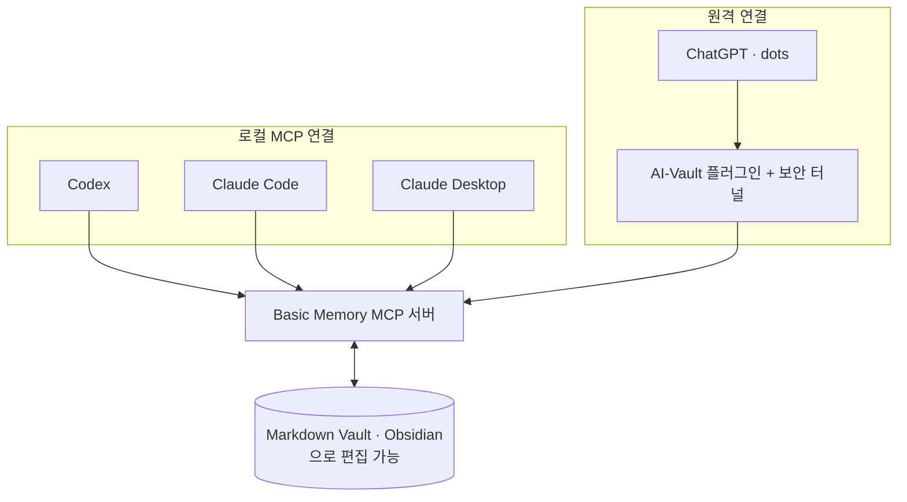

# AI Context Vault

[](https://github.com/UiHyeon-Kim/ai-context-vault/actions/workflows/ci.yml)
[](LICENSE)

ChatGPT·Codex·Claude가 **같은 Markdown 노트를 읽고 써서 작업 맥락을 이어 가게 하는 설정·운영 스타터킷**이다

노트 저장·검색은 외부 도구 [Basic Memory](https://docs.basicmemory.com/)(MCP 서버)가 맡고, 이 저장소는 그 위에서 쓰는 연결 설정 예시, 기록 규칙, 인계 양식, 설치 점검 도구, 가상 데모 Vault를 제공한다

여러 AI를 번갈아 쓰며 “아까 정한 것”을 매번 다시 설명하는 사람을 위한 구성이다. 클라우드 가입, 별도 서버, 데이터베이스 운영은 필요 없다 (로컬 Basic Memory를 쓴다)

> **지원 환경: macOS**(Basic Memory 0.22.1로 직접 검증). Linux·Windows는 지원 대상이 아니다 — CI에서 단위 테스트와 Basic Memory 연동 시험이 통과한 사실만 있고 클라이언트 연결·실사용은 검증하지 않았다 ([지원 환경](docs/status.md#지원-환경))

## 어떻게 동작하나

AI는 대화가 끝나면 맥락을 잃고, 다른 AI는 그 대화를 모른다. 이 구성은 중요한 결정·근거·남은 일을 **노트로 저장**하고 다음 AI가 **그 노트를 다시 읽게** 한다



1. AI가 Vault의 짧은 운영 규칙(README)을 읽고 관련 주제의 **현재 요약**부터 조회한다
2. 대화에서 확정한 결정·이유·근거·남은 일을 현재 요약에 갱신하고, 긴 실행 기록은 **상세 이력** 노트로 분리한다
3. 다른 AI가 같은 노트의 최신 내용을 읽고 작업을 이어 간다

전체 대화를 실시간으로 복제하지 않는다. **저장한 노트만** 공유되며, 저장하지 않은 내용을 다른 AI가 안다고 가정하지 않는다

## 무엇을 제공하나

| 구분 | 내용 |
|---|---|
| **외부 도구** (이 저장소가 만들지 않음) | [Basic Memory](https://docs.basicmemory.com/) — 노트 색인·검색·읽기·쓰기 MCP 도구 (AGPL-3.0-or-later). Obsidian, OpenAI tunnel-client |
| **이 저장소** | 현재 요약 / 상세 이력 / 인계 노트 구조와 [양식](templates), AI [공통 지침](prompts/shared-context.md), [설정 예시](examples), 사전 검사 `vault_doctor.py`, 안전한 설정 병합 `merge_mcp_config.py`, [데모 Vault](examples/demo-vault/README.md)와 재현 시험 스크립트 |

새 메모리 제품, MCP 서버, 검색 엔진, 동기화 서비스가 아니다. 현재 요약/상세 이력 구분은 노트 메타데이터(`context_role`)와 운영 규칙이며 자동 요약 프로그램이 아니다. 자세한 분류는 [기능 상태와 책임 구분](docs/status.md)

## 먼저 데모로 확인하기

실제 설정을 건드리기 전에 가상 데모 Vault로 전체 흐름을 재현할 수 있다. 임시 폴더(`HOME`, Basic Memory 설정, Vault 사본)만 쓰고 끝나면 지운다

```sh
python3 scripts/demo_roundtrip.py
```

```text
[PASS] 1. 프로젝트 등록(임시 설정) — demo-vault: indexed and settled — 5 notes from 5 files
[PASS] 2. vault_doctor 사전 검사 — 오류 0건
[PASS] 3. 색인(reindex --full) — 텍스트·임베딩 색인 완료
[PASS] 4. 한글 텍스트 검색 '클라우드' → 해당 노트만 — 결과 ['Sample-Notes-App']
…
[PASS] 9. 노트 읽기(현재 요약: 현재 상태·보류·금지·사실/추정 구분)
[PASS] 10. 테스트 노트 작성 후 재조회
…
[PASS] 15. 백업 리허설: 삭제 시 검색에서 사라지고, 복구 후 reindex로 다시 검색됨 — 삭제 후 [] / 복구 후 ['데모 테스트 노트']

통과 15 / 경고 0 / 실패 0 (총 15)
```

2026-10-28 macOS, Basic Memory 0.24.1에서 실행한 출력의 일부다(5~8, 11~14단계 생략). 첫 실행에서 Basic Memory가 임베딩 모델을 내려받아 이번 실행은 약 1분 30초 걸렸다. 이 시험은 도구 계층의 동작 확인이며, 채팅 속 AI가 규칙을 따르는지는 [채팅 검증](docs/chat-verification.md)으로 따로 확인한다

AI가 남기는 인계 노트는 이런 모습이다 ([데모 현재 요약](examples/demo-vault/Projects/Sample-Notes-App.md)에서 발췌)

```markdown
## 현재 상태 (2026-01-05 기준)

- 구현 완료: 메모 목록·검색 화면
- 빌드·설치·실사용 검증: 모두 미수행 (가상 프로젝트라 빌드 대상이 없음). "구현 완료"를 "검증 완료"로 읽지 않는다

## 확정한 결정과 이유

| 구분 | 내용 |
|---|---|
| 사용자 결정 | 첫 버전은 로컬 저장만 지원한다 (일정 때문) |
| AI 제안(미확정) | 충돌 해결에 마지막 수정 우선 규칙을 쓰자 |

## 보류·금지 범위

- 보류: 클라우드 동기화 서버 선택 (사용자 승인 전까지 진행하지 않음)
- 금지: 사용자 데이터 외부 전송, 실제 계정 연결
```

구현과 검증 단계, 사용자 결정과 AI 제안, 하면 안 되는 일을 나눠 적어서 다음 AI가 "구현됨"을 "검증됨"으로, 제안을 결정으로 잘못 이어받지 않게 한다

## 설치

| 필요한 것 | 비고 |
|---|---|
| macOS | 지원 환경. 셸 예시는 zsh·bash 기준 |
| Python 3.11 이상 | 이 저장소의 스크립트용. macOS 기본 `/usr/bin/python3`(3.9)에서는 안내 메시지를 내고 멈춘다 |
| [Basic Memory](https://docs.basicmemory.com/start-here/quickstart-local) | 검증한 버전 고정: `uv tool install basic-memory==0.22.1` (또는 `pip install basic-memory==0.22.1`). Basic Memory 자체는 Python 3.12 이상을 요구한다 |
| Markdown 폴더 하나 | Obsidian Vault여도 되고 새 폴더여도 된다. 기존 노트가 있으면 먼저 폴더째 백업한다 ([유지보수](docs/maintenance.md)) |

이 저장소는 패키지로 배포하지 않는다. `git clone`으로 받아 스크립트와 양식을 그대로 쓴다

## 빠른 시작

Codex에 연결하는 기본 경로다. 다른 클라이언트와 단계별 설명은 [빠른 시작 문서](docs/quickstart.md)

```sh
# 1. Vault 폴더를 Basic Memory 프로젝트로 등록
basic-memory project add ai-vault /ABSOLUTE/PATH/AI-Vault --local

# 2. 사전 검사 (읽기 전용, 아무것도 수정하지 않음)
python3 scripts/vault_doctor.py --vault /ABSOLUTE/PATH/AI-Vault --project ai-vault

# 3. 클라이언트 설정에 basic-memory 항목만 병합 — 기본은 미리보기, 내용이 맞으면 같은 명령에 --apply
python3 scripts/merge_mcp_config.py --format codex-toml --target "$HOME/.codex/config.toml" \
  --command "$(command -v basic-memory)" --project ai-vault
```

`--apply`는 백업(`.bak-타임스탬프`)을 만든 뒤 쓰고, 다시 실행해도 같은 항목을 중복으로 넣지 않는다. Claude Code는 `claude mcp add --scope user …`, Codex는 `codex mcp add …` 공식 명령도 쓸 수 있다 ([클라이언트별 연결](docs/quickstart.md#4-ai-클라이언트에-연결))

마지막으로 새 채팅에서 [연결 시험 문구](prompts/roundtrip-test.md)를 보내 읽기 → 검색 → 기록 → 재조회를 확인한다. 첫 검색이 0건이면 [빠른 시작의 해결 방법](docs/quickstart.md#처음-검색이-0건일-때)을 본다

## 사용 예시

작업 시작·재개

> AI-Vault(`ai-vault`)의 README를 먼저 읽고, Sample Notes App의 현재 요약부터 찾아 읽어줘. 상세 이력은 근거가 필요할 때만. 확정한 결정과 남은 일을 정리한 뒤 이어서 진행해줘

결정 저장

> 방금 확정한 결정·이유·보류 범위를 해당 현재 요약에 갱신하고, 사용자 결정과 AI 제안을 구별해줘. 마지막 수정 후 다시 읽어 저장을 확인해줘

더 많은 문구는 [평소 사용하는 방법](docs/usage.md)

## 설정과 문서

| 알고 싶은 것 | 문서 |
|---|---|
| 표시 이름·프로젝트 ID·폴더 이름의 차이 | [이름 구분](docs/naming.md) — 문서는 표시 이름 `AI-Vault`, 프로젝트 ID `ai-vault`를 쓴다 |
| 로컬 MCP, ChatGPT 터널, 로그인 시 자동 실행 | [설정 방법](docs/setup.md) |
| 예시 설정 파일 | [`examples/`](examples) — `/ABSOLUTE/PATH`, `REPLACE_WITH_TUNNEL_ID`는 반드시 바꾼다. `vault_doctor.py`가 남은 자리 표시자를 찾아 준다 |
| 노트 구조와 양식 | [현재 요약과 상세 이력](docs/context-structure.md), [인계 양식](templates/handoff.md), [Vault README 양식](templates/vault-readme.md) |
| 검색 0건, 도구 오류, 쓰기 응답 손실 | [오류 대응](docs/troubleshooting.md) — 설정이 의심되면 `vault_doctor.py`부터 실행 |
| 백업·복구·업데이트·제거 | [유지보수](docs/maintenance.md) |
| AI가 규칙을 따르는지 시험하는 방법 | [채팅 검증](docs/chat-verification.md) |

## 지원 범위와 한계

- **macOS만 지원한다.** Linux·Windows의 문제는 처리하지 않을 수 있다 (CI 통과 사실은 보장이 아니다)
- **AI가 지침을 항상 따른다는 보장이 없다.** 중요한 인계는 저장 위치를 명시하고 재조회로 확인한다
- **쓰기 안전은 서버 기능이 아니라 운영 규칙이다.** 확인 없이 `append`를 반복하면 중복되고, 없는 노트에 `append`하면 오류 없이 새 노트가 생긴다. 편집 실패는 Basic Memory 0.22.1·0.23.2에서 `isError` 없이 온다(0.24.1에서는 `isError=True`) — 모두 시험으로 확인했다
- **새 Vault는 색인 전 검색이 비어 있을 수 있다.** 임베딩 모델을 받지 못한 환경에서는 기본(hybrid) 검색이 비므로 `search_type=text`를 쓴다
- ChatGPT·dots는 Vault가 있는 컴퓨터가 켜져 있고 터널이 동작해야 쓸 수 있다. dots의 자체 기억과 AI-Vault는 별개다
- 코드·ADR·백로그의 정본은 각 프로젝트 저장소다. Vault에는 요약과 링크만 둔다

## 검증 현황

| 검증 | 결과 |
|---|---|
| 단위 테스트 `python3 -m unittest discover -s tests` | 52개 통과 (macOS: Python 3.11·3.12·3.14·3.15) |
| GitHub Actions | 단위 테스트 Ubuntu·Windows × Python 3.11·3.13 통과. 연동 시험 Ubuntu·Windows + Basic Memory 0.22.1: 격리 재현 15/15, 오프라인 흉내 14 + 경고 1, MCP 계층 11/11 (2026-10-22). 최신 버전은 실험적 잡으로 감시 |
| 로컬 격리 재현 `demo_roundtrip.py` · MCP 계층 `mcp_stdio_check.py` | 0.22.1(2026-10-22)과 0.24.1(2026-10-28) 모두 15/15, 11/11 |
| 실제 ChatGPT/Codex/Claude 채팅 연결 | 작성자 환경 기록(재현 불가)만 있음, 2026-10 |
| 채팅 속 AI의 새 인계 양식 준수 | 미검증 — 확인 절차는 [채팅 검증](docs/chat-verification.md) |

“MCP 호출이 된다”와 “채팅 속 AI가 지침을 따른다”는 서로 다른 검증이다. 시험 방법과 날짜별 기록은 [검증 현황](docs/verification.md)

## 이 저장소에 넣지 않는 것

개인 노트 본문, 채팅 내보내기, 실행 로그, 인증 키, 실제 터널 ID와 사용자별 설정은 포함하지 않는다. `.gitignore`는 실수 방지용이므로 올리기 전 실제 변경사항을 확인한다 (`vault_doctor.py`의 비밀값 검사도 보조로 쓸 수 있다)

## 라이선스

[MIT](LICENSE) — 이 저장소의 파일에만 적용된다. Basic Memory(AGPL-3.0-or-later), OpenAI tunnel-client, Obsidian은 각자의 라이선스를 따르며 이 저장소에 포함하지 않는다. 선택 근거는 [라이선스 선택과 근거](docs/license-options.md)

## 공식 참고 자료

- [Basic Memory 로컬 설치](https://docs.basicmemory.com/start-here/quickstart-local) · [Basic Memory와 Obsidian](https://docs.basicmemory.com/integrations/obsidian/)
- [OpenAI Secure MCP Tunnel](https://developers.openai.com/api/docs/guides/secure-mcp-tunnels) · [ChatGPT 플러그인 연결](https://developers.openai.com/plugins/deploy/connect-chatgpt)
- [dots 컴퓨터·앱 연결](https://learn.chatgpt.com/docs/dots/computers-and-apps) · [dots 작업·기억](https://learn.chatgpt.com/docs/dots/tasks-and-memory)
